# Midterm Project - Implement ls(1)

**Sinh viên:** Lê Văn Kiệt - **MSSV:** 24IT131 - **Lớp:** 24SE1  
**Repository:** https://github.com/vankiet26/LeVanKiet_24IT131_midterm

## 1. Mục tiêu

Tự xây dựng `myls` bằng C để liệt kê thông tin file/thư mục, theo tập tùy chọn
trong tài liệu `ls.pdf` (NetBSD 10.1). Chương trình trực tiếp gọi các API hệ thống;
không dùng `system("ls")`, `popen("ls")` hoặc thực thi lệnh `ls` có sẵn.

## 2. Cấu trúc và trách nhiệm các module

| File | Trách nhiệm |
| --- | --- |
| `include/myls.h` | Khai báo cấu trúc Options, Entry, Entries, Ancestor và giao diện hàm |
| `src/main.c` | Phân loại đối số file/thư mục; điều phối; trả mã thoát |
| `src/options.c` | Đọc tùy chọn và BLOCKSIZE; xử lý tùy chọn xuất hiện sau |
| `src/directory.c` | opendir/readdir/closedir, lstat, duyệt đệ quy và phát hiện chu trình |
| `src/sort.c` | Sắp xếp tên, kích thước, thời gian và đảo thứ tự |
| `src/output.c` | Quyền truy cập, chủ sở hữu, nhóm, kích thước, thời gian, inode, symlink |
| `src/util.c` | Cấp phát bộ nhớ, ghép đường dẫn, quản lý mảng và báo lỗi |
| `Makefile` | Biên dịch, kiểm thử và dọn sản phẩm biên dịch |
| `tests/test_myls.py` | 12 nhóm kiểm thử hành vi tự động |
| `HUONG_DAN_CHUP_ANH.md` | Các bước thực hành, lệnh và danh sách ảnh minh chứng |

Các file C dùng chung một header chứa giao diện của các module. Cấu trúc này
giữ mã nguồn modular mà không tạo nhiều header có nội dung trùng lặp.

## 3. Biên dịch và chạy

Môi trường mục tiêu: Linux/Ubuntu, GCC, GNU Make; Python 3 chỉ cần cho `make test`.

```bash
sudo apt update
sudo apt install -y build-essential python3 git unzip
make
./myls
./myls -al .
./myls -R .
make test
make clean
```

Khi không truyền đối số, chương trình liệt kê thư mục hiện tại. Mỗi tên được
in trên một dòng, đúng mô tả mặc định của tài liệu. Truyền tùy chọn trước đối số;
dùng `--` trước tên bắt đầu bằng dấu `-`.

## 4. Tùy chọn đã thực hiện

| Tùy chọn | Hành vi |
| --- | --- |
| `-A` | Liệt kê cả file ẩn, loại `.` và `..`; mặc định bật khi chạy bằng root |
| `-a` | Liệt kê mọi mục, kể cả `.` và `..` |
| `-c` | Chọn thời gian thay đổi metadata (ctime) cho `-l`/`-t` |
| `-d` | In chính đối số thư mục, không liệt kê nội dung |
| `-F` | Thêm `/`, `*`, `@`, `=`, `\|` cho thư mục, file thực thi, symlink, socket, FIFO |
| `-f` | Không sắp xếp; giữ thứ tự đọc từ thư mục/thứ tự đối số trong từng nhóm |
| `-h` | Kích thước `-l` và `-s` dạng B/K/M/G... với cơ số 1024 |
| `-i` | In inode |
| `-k` | Số khối của `-s` dùng đơn vị 1024 byte; không đổi cột byte trong `-l` |
| `-l` | In loại file, quyền, số liên kết, owner, group, kích thước, thời gian, tên |
| `-n` | Như `-l`, nhưng UID/GID dạng số |
| `-q` | Thay ký tự không in được bằng `?`; mặc định khi stdout là terminal |
| `-R` | Liệt kê đệ quy thư mục con |
| `-r` | Đảo thứ tự sắp xếp |
| `-S` | Sắp xếp kích thước giảm dần |
| `-s` | In số khối thực sự chiếm trên hệ thống file, làm tròn lên |
| `-t` | Sắp xếp thời gian mới nhất trước, cùng thời gian thì theo tên |
| `-u` | Chọn thời gian truy cập (atime) cho `-l`/`-t` |
| `-w` | In nguyên ký tự tên file; mặc định nếu stdout không phải terminal |

`-q/-w`, `-l/-n`, `-c/-u`, `-R/-d`, `-h/-k`: tùy chọn nằm bên phải có ưu tiên.
Trong nhóm chọn kiểu sắp xếp `-f/-S/-t`, tùy chọn sau cùng chọn kiểu sắp xếp.
`-r` không có tác dụng khi không sắp xếp. `-f` không tự bật `-a`, theo mô tả
trong PDF; không dùng hành vi mở rộng của GNU ls làm chuẩn cho tùy chọn này.

Các đối số không phải thư mục được in trước. Hai nhóm file và thư mục được
sắp xếp riêng. Trường hợp tên trùng tiêu chí thời gian/kích thước dùng tên để
phân định. Không trừ trực tiếp số inode, kích thước hoặc timestamp trong comparator
để tránh tràn số.

## 5. Thông tin hệ thống file và xử lý lỗi

- `lstat` giữ metadata của liên kết tượng trưng; `readlink` đọc đích và thêm `->` ở dạng dài.
- Liên kết đến thư mục truyền trực tiếp được duyệt ở chế độ mặc định, trừ khi dùng
  `-d`, `-l`/`-n` hoặc `-F`. Liên kết tìm thấy trong thư mục không được duyệt đệ quy.
- Không duyệt `.`/`..` khi đệ quy; kiểm tra cặp device/inode của các thư mục tổ tiên.
- Quyền được thể hiện thành `rwx`, bao gồm `s/S`, `t/T` cho setuid/setgid/sticky.
- File thiết bị hiển thị major/minor ở cột kích thước. UID/GID không tìm được tên
  sẽ được in dạng số. Kích thước thư mục là `st_size`, không phải tổng nội dung.
- `-s` dùng `st_blocks * 512`, phân biệt dung lượng cấp phát với kích thước logic.
- Với `-l`/`-n`, in `total` trước nội dung thư mục. Với `-s` độc lập, chỉ in tổng
  khi stdout là terminal, theo PDF.
- `BLOCKSIZE` đặt đơn vị mặc định cho khối; chấp nhận số nguyên dương và hậu tố
  K/M/G. Giá trị không hợp lệ dùng 512 byte; `-h`/`-k` ghi đè đơn vị này.
- `TZ` được áp dụng qua `localtime_r`. Tên UTF-8 được đọc bằng `mbrtowc`, không
  thay các ký tự tiếng Việt hợp lệ bằng `?` trong locale UTF-8.
- Lỗi đường dẫn, quyền, đọc thư mục, readlink được báo ra stderr. Các đối số hợp
  lệ còn lại vẫn được xử lý. Mã thoát 0 khi thành công và 1 khi có lỗi.
- Bộ nhớ chứa danh sách/đường dẫn được giải phóng. Đường dẫn không bị giới hạn
  bằng một mảng PATH_MAX cố định.

## 6. Khác biệt môi trường cần hiểu

PDF là manual NetBSD, còn bản này chạy trên Linux. Các loại file NetBSD đặc thù
`a/A` (archive state) và `w` (whiteout) không được Linux thông thường cung cấp
qua `lstat`; không tạo dữ liệu giả để minh họa. Có nhánh `S_ISWHT` có điều kiện
cho marker `%`, nhưng không thể kiểm thử whiteout trên Linux này. Mã nguồn
dùng API Linux như `sys/sysmacros.h` và không cam kết biên dịch nguyên trạng
trên NetBSD. Căn cột/human-size có thể khác tiện ích NetBSD gốc, nhưng giữ các
trường và ý nghĩa theo tài liệu. Sắp xếp tên dùng bytewise `strcmp`, tương ứng
với locale C. Không triển khai các tùy chọn nằm ngoài PDF như `--color`/`-L`.

## 7. Kiểm thử

```bash
make test
```

Đã chạy trên máy sinh viên Ubuntu với GCC 15.2, GNU Make 4.4.1.
Kết quả `make test`: **12 nhóm kiểm thử đạt**, `OK`, mã thoát **0**.
Bộ kiểm thử bao phủ file ẩn, sắp xếp, thời gian, quyền đặc biệt, inode/blocks,
UID/GID, symlink, FIFO/socket, đệ quy, tên UTF-8/ký tự điều khiển, thư mục rỗng,
nhiều đối số, xử lý lỗi và TZ. Minh chứng thực hành bên dưới bổ sung phép thử
thư mục không có quyền truy cập. Các kiểm thử không phải cam kết bao phủ mọi
trường hợp của tiện ích NetBSD gốc; các giới hạn nền tảng nêu ở mục 6.

## 8. Minh chứng thực hành

Ảnh chụp trực tiếp trong quá trình chạy bài ngày 13/10/2026, giữ nguyên nội dung
và đặt tên theo thứ tự. Đường dẫn ảnh tương đối để hiển thị trong README trên GitHub.

### 8.1. Biên dịch và cấu trúc module

GCC 15.2 và GNU Make 4.4.1 trên Ubuntu. Các module biên dịch và liên kết thành myls, không thấy lỗi hay cảnh báo.

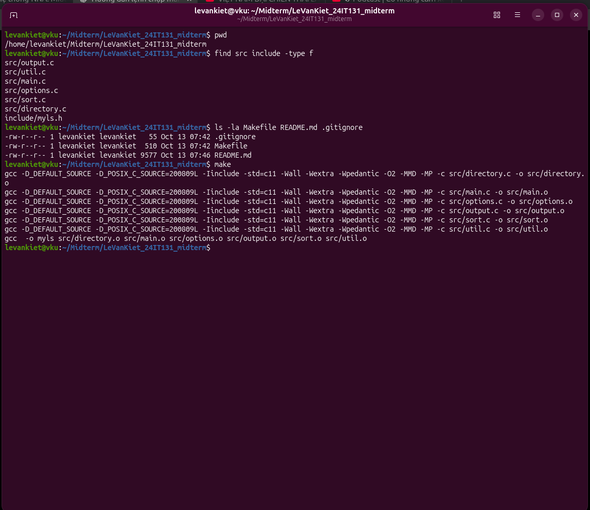

### 8.2. Liệt kê mặc định và file ẩn

Mặc định không có .hidden; -A có .hidden nhưng không có . và ..; -a có cả ba.

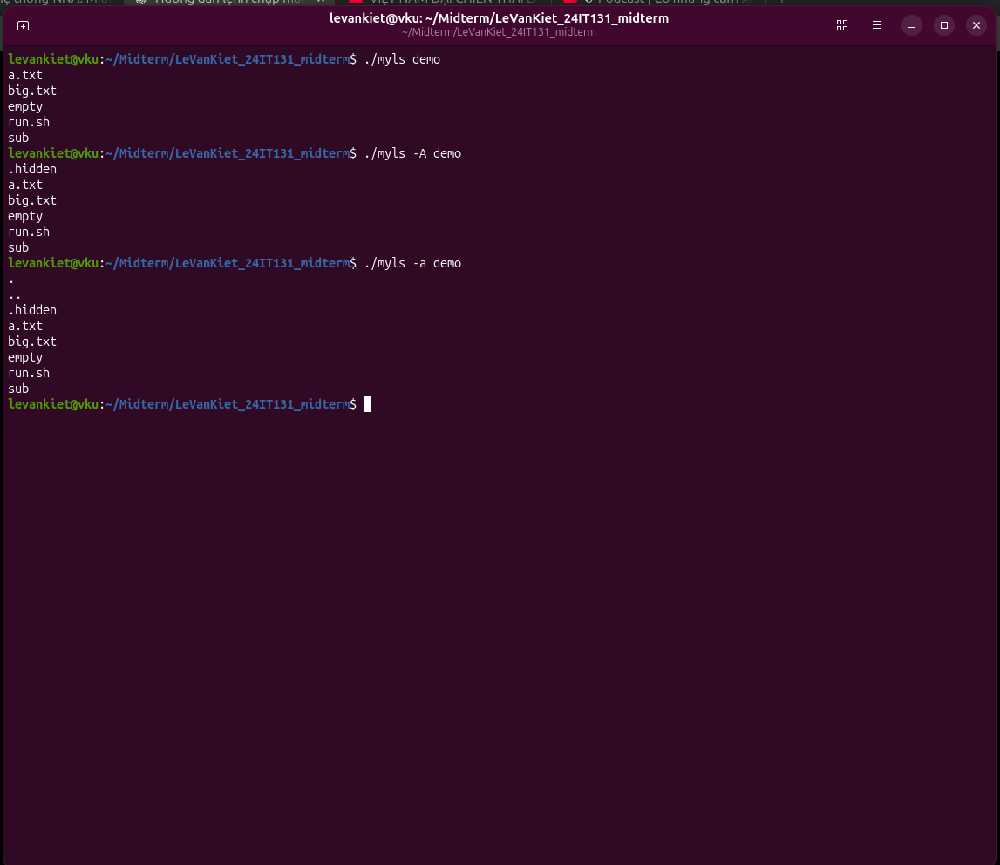

### 8.3. Thông tin file và inode

a.txt có kích thước 4 byte, UID/GID 1000. Inode 793982 khớp stat. run.sh có quyền thực thi, link_a hiển thị đích a.txt.

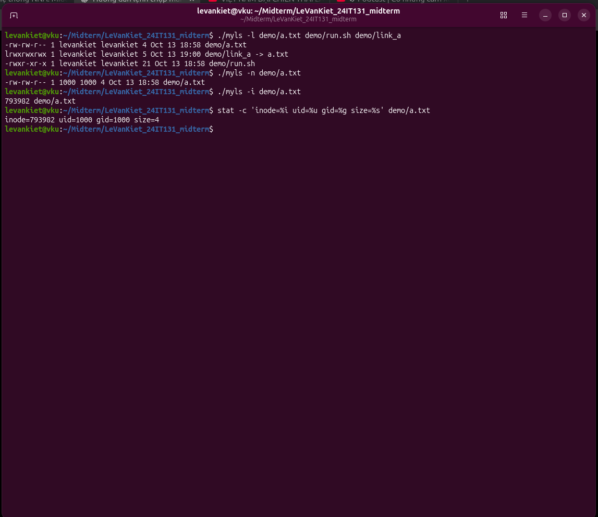

### 8.4. Phân loại và duyệt đệ quy

Các marker /, *, @, |, = hiển thị đúng. -d chỉ in đối số thư mục; -R liệt kê empty và sub, không duyệt vòng qua symlink back.

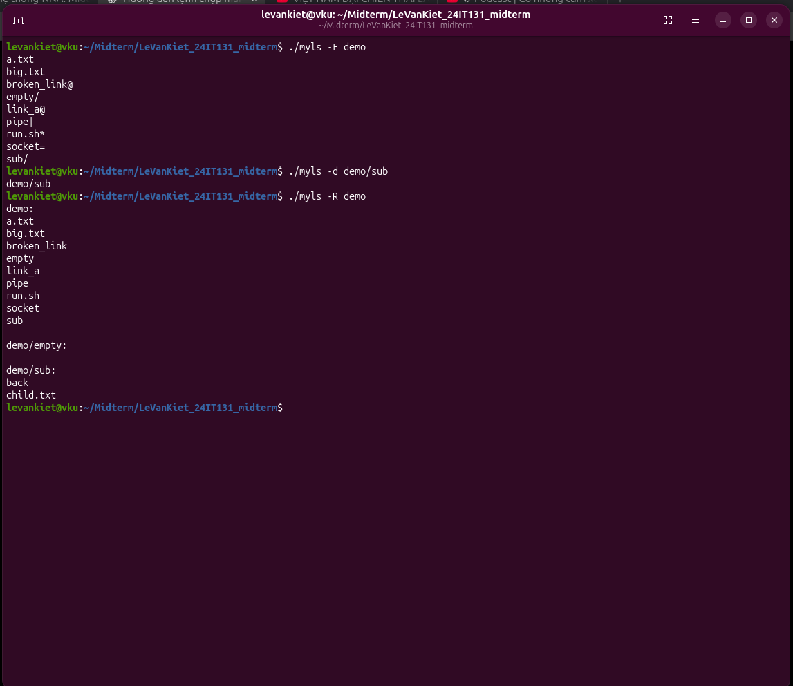

### 8.5. Sắp xếp

Thứ tự theo tên, kích thước và thời gian đúng; -r đảo thứ tự; -f giữ thứ tự đối số big.txt rồi a.txt.

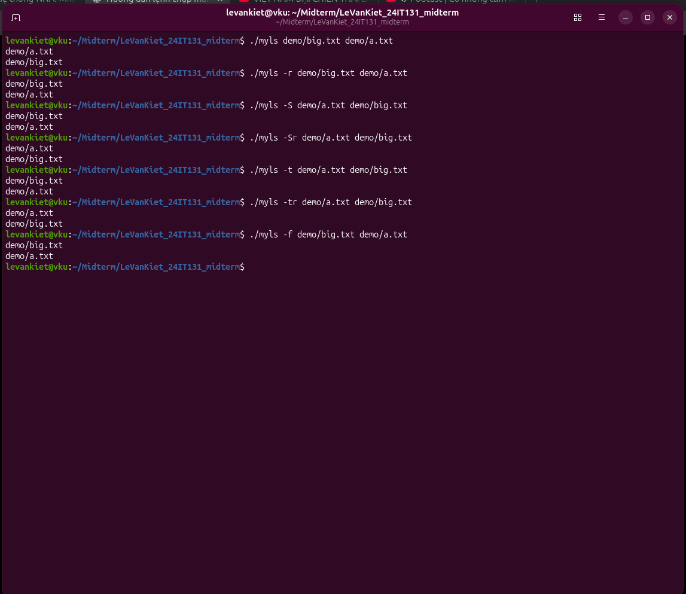

### 8.6. Dung lượng và BLOCKSIZE

big.txt có 8192 byte và 16 block 512 byte. -sk và BLOCKSIZE=1024 cho 8 block; -h hiện 8.0K. -shk ưu tiên k; -skh ưu tiên h.

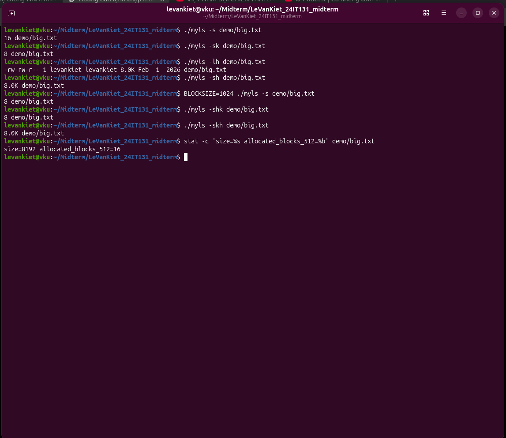

### 8.7. mtime, atime và ctime

-lt dùng mtime, -ltu dùng atime; chmod 600 đổi quyền và cập nhật ctime. -lc khớp mốc ctime do stat hiển thị.

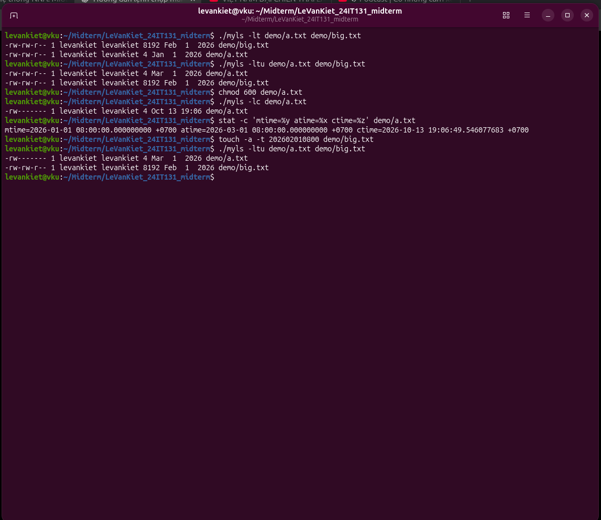

### 8.8. Ưu tiên tùy chọn và TZ

-ln in UID/GID số, -nl in tên; -Rd chỉ in thư mục, -dR duyệt nội dung. UTC 12:08 và Việt Nam 19:08 lệch 7 giờ.

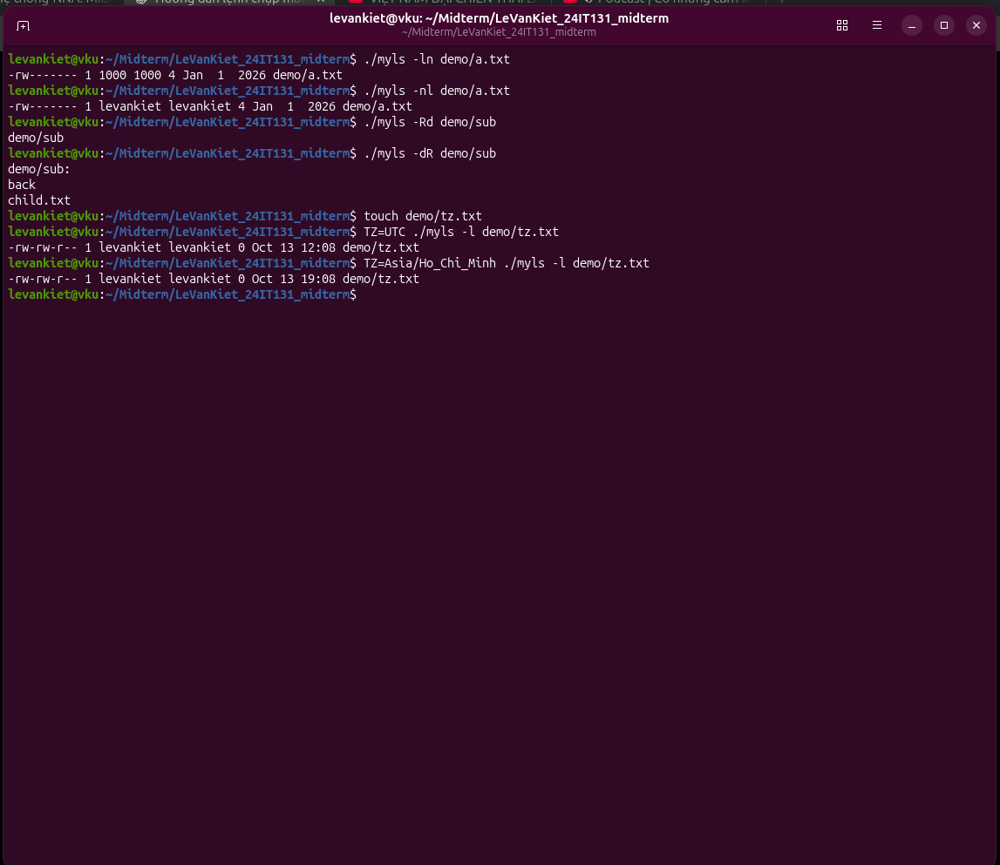

### 8.9. Ký tự điều khiển và UTF-8

-q thay tab bằng dấu ?, -w giữ tab (cat -vT biểu diễn ^I). Tùy chọn sau cùng có ưu tiên. Tên tiếng Việt được giữ đúng trong locale C.UTF-8.

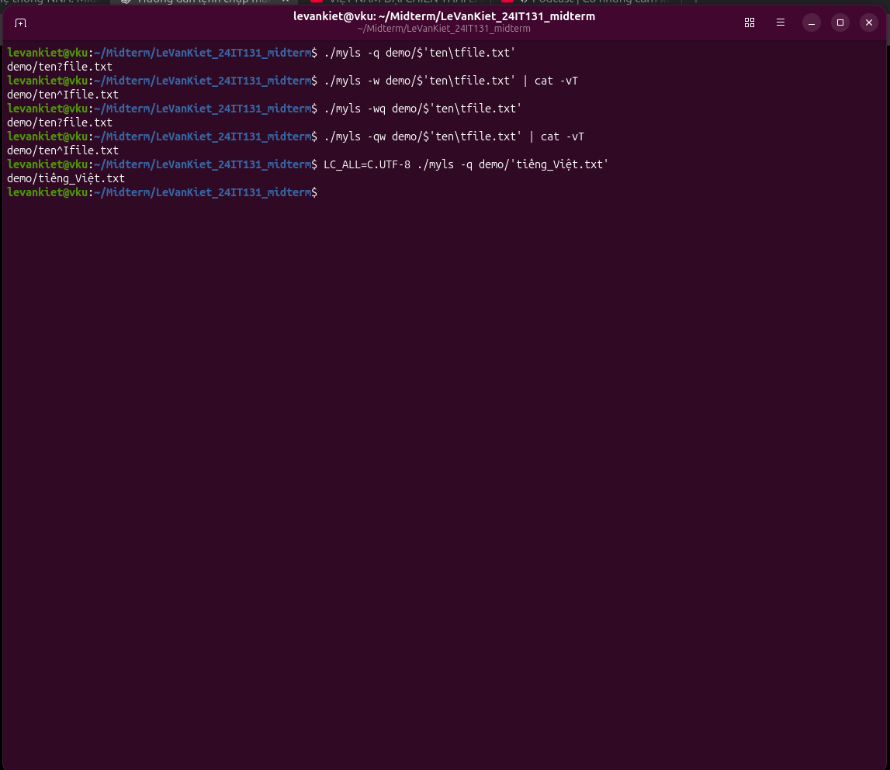

### 8.10. Liên kết hỏng, thư mục rỗng và đối số sai

Symlink hỏng vẫn được liệt kê với đích; thư mục rỗng có total 0. Đường dẫn không tồn tại và -z báo lỗi, trả mã 1.

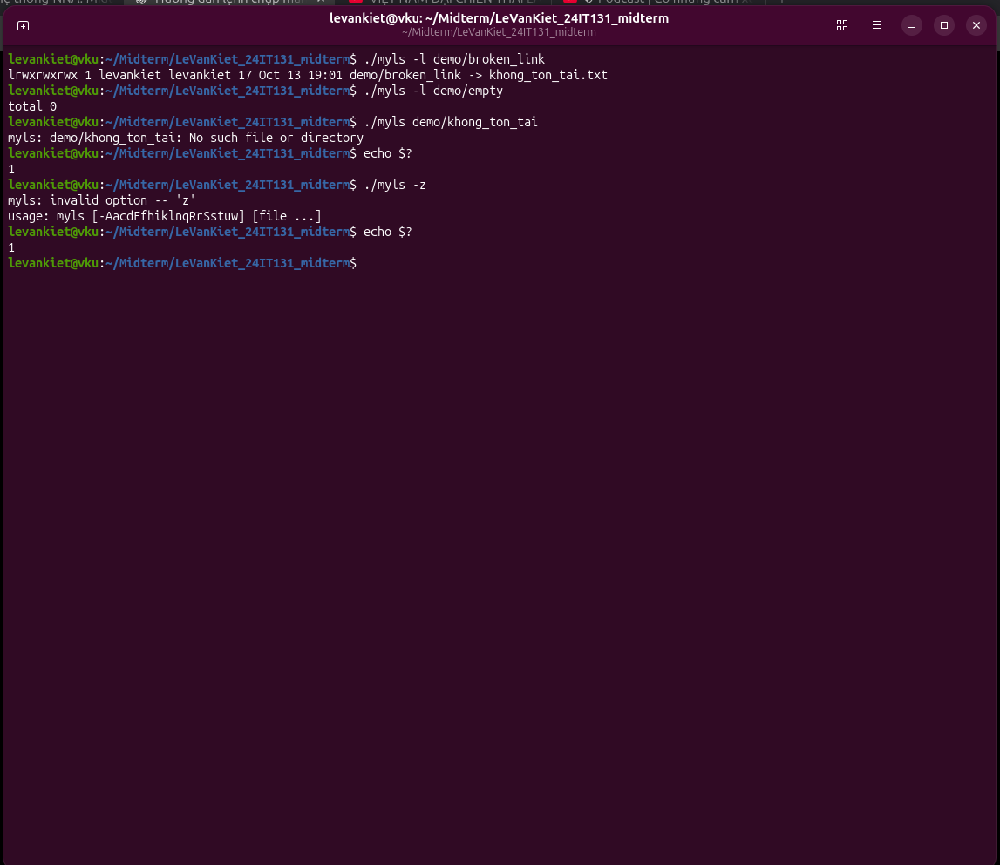

### 8.11. Quyền truy cập và nhiều đối số

Thư mục quyền 000 báo Permission denied, mã 1; sau đó khôi phục 755. Khi có đường dẫn sai, đối số a.txt hợp lệ vẫn được in.

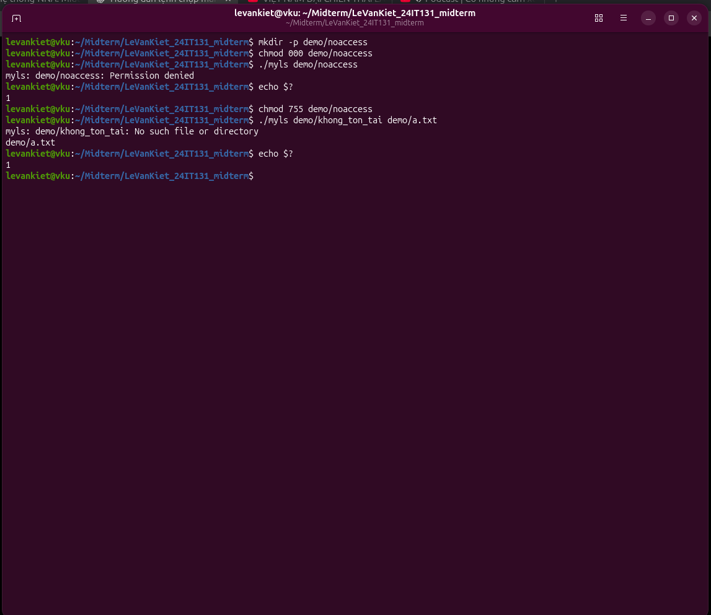

### 8.12. Kiểm thử tự động

make test hoàn tất: Ran 12 tests in 0.073s, OK; echo $? trả 0. Không có thông báo bỏ qua tạo Unix socket trong lần chạy này.

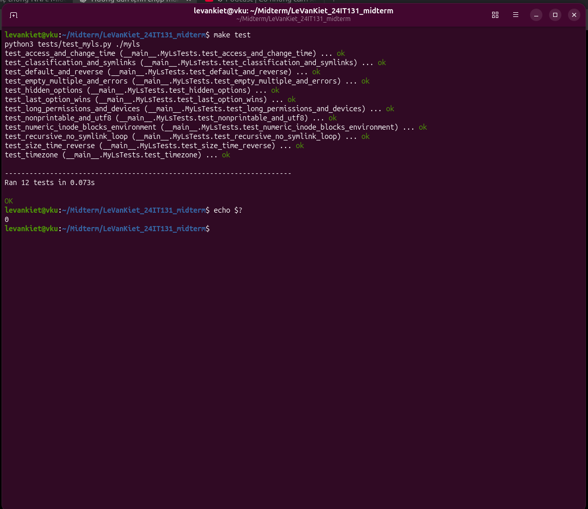

## 9. Nộp bài

Repository phải có tên `LeVanKiet_24IT131_midterm`, theo mẫu
`Name_studentID_midterm`. URL repository thực tế phải được điền ở đầu README trước khi gửi
báo cáo qua e-learning. Việc chạy thành công chưa thay thế bước nộp bài. Không commit `myls`, `.o`, `.d`, dữ liệu demo
hay file ZIP. Ảnh đề hiển thị hạn nộp **14/10/2026, 13:00**; kiểm tra lại
múi giờ/hạn trên trang học trước khi gửi.

## 10. Tài liệu tham khảo

Manual `ls(1)` NetBSD 10.1 do giảng viên cung cấp, ngày 27/10/2024,
3 trang (`ls.pdf`). Bài tập: Midterm Project - Implement ls() - (4).
